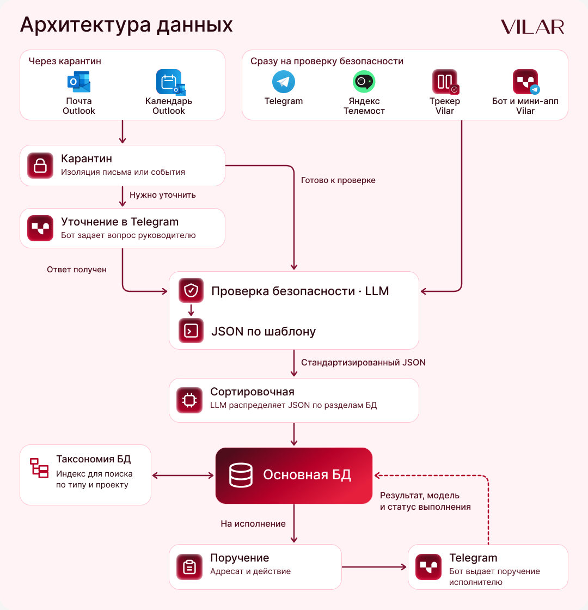

# Архитектура данных Vilar · v1.0

27 ноября 2026 года. Команда приняла эту схему как целевой маршрут разработки.

## Как читать схему

1. Письма и события календаря Outlook попадают в карантин. Когда для допуска нужны сведения, бот задает вопрос руководителю. После ответа событие возвращается на проверку безопасности.
2. Чаты Telegram, Телемост, трекер и мини-приложение передают события сразу на проверку безопасности. Отдельный этап уточнения для Outlook показан слева. На обеих ветках оригинал и каждое вложение проверяются отдельно и могут быть удержаны.
3. После допуска формируется JSON по шаблону. В сортировочной языковая модель предлагает привязку к делам и разделам базы. Сервер проверяет права, основание и версию перед записью.
4. Таксономия помогает найти в основной базе поручения по типу и проекту. На рисунке она выделена как функция поиска. Отдельное физическое хранилище для нее не требуется.
5. Для выдачи через Telegram база передает поручение с адресатом и действием. Бот фиксирует доставку. Отдельно поступают результат и статус исполнения. Если действие выполняла модель, нужен ее идентификатор. Доставка сообщения сама по себе поручение не закрывает. Трекер также может возвращать результат своего исполнительского шага.

## Что подтверждено

| Участок | Состояние на дату версии |
| --- | --- |
| Прием источников | В открытом репозитории есть адаптер Outlook. В рабочей ветке приема есть сценарии писем, календаря и изменений сообщений Telegram. Одновременная работа всех шести источников на стенде этой сверкой не подтверждена. |
| Карантин и JSON | Договор ядра описывает независимый допуск оригинала и вложений. Полный живой цикл с вопросом бота, ответом руководителя и повторной проверкой остается критерием приемки. |
| Сортировка и поиск | В рабочих ветках есть хранение, маршрутизация и версии. Часть проверок начинается с уже допущенного события. Это оставляет отдельную проверку обеих моделей на полном пути от источника до записи. |
| Поручения | Подтверждена отправка оформленного сообщения Vilar в личный Telegram. Для приемки поручения нужен другой результат: адресат получает реальный шаг, отвечает, а в базе меняется статус нужной версии. Идентификатор модели проверяется отдельно на шаге, выполненном моделью. |

Версия описывает согласованную архитектуру. Сквозная приемка требует пройти обе входные ветки и вернуть в базу результат одного выданного поручения.

Публичный адаптер: [Outlook](../../../integrations/outlook/README.md).

В командной версии бота `2913987` обычные карточки используют каталог эмодзи Vilar. Утренний план и решения берутся из макетов, квитанция доставки имитируется задержкой. Фактический возврат результата в ядро остается открытым стыком.
